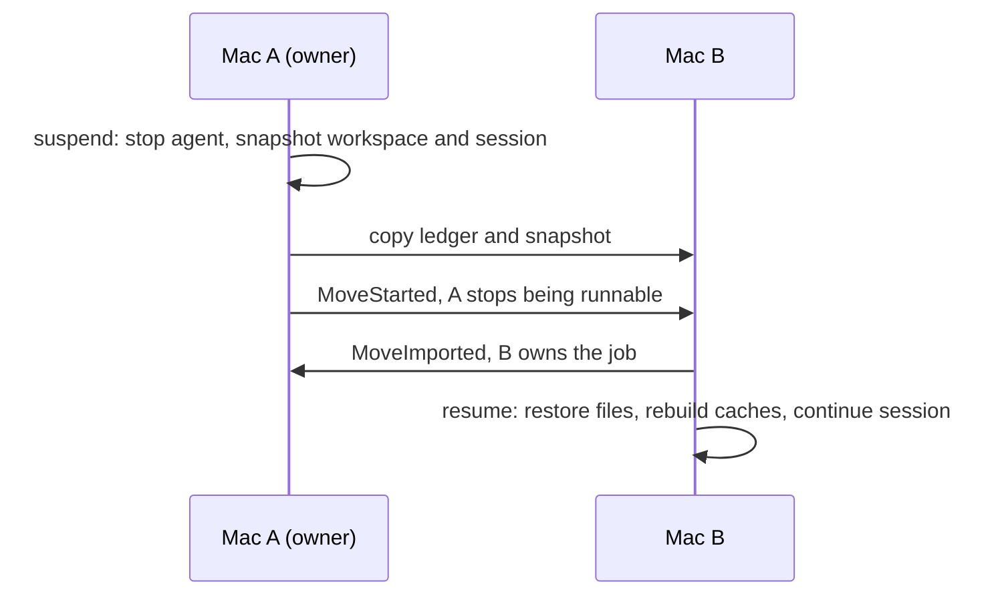

# Fabric

Fabric moves a coding-agent job from one machine to another and lets you pick it up where it stopped. The workspace goes with it: staged and unstaged changes, untracked files, dependency caches and build output. So does the agent's session, so Claude Code or Codex continues the same conversation on the other machine. Secrets stay behind.

The idea underneath is that the job, not the machine, is the unit of development work. Where a job's state is stored, which machine runs it, which toolchain it needs and which agent drives it are separate questions, and Fabric keeps them separate.

Fabric is a working name. It collides with Microsoft Fabric and others, and may change.

## Status

Early. The code is not on `main` yet. It is in a stack of open pull requests under review, and `main` holds only the workspace skeleton until they merge. Read the newest code on the [`feat/client-api`](https://github.com/EfeDurmaz16/fabric/tree/feat/client-api) branch, which sits at the top of the stack.

The first real run between two Macs passed on 2026-10-21. A Codex job started on one Mac, answered a first turn, and was suspended and moved to the other Mac. There it resumed and answered a question about its first turn, so the conversation carried over.

| Step | Measured |
|---|---|
| Suspend: stop the agent, snapshot the workspace and session | 0.85 s |
| Move to the other Mac | 1.15 s |
| Resume and run one headless turn there | 6 s |
| Workspace on the target | git status, staged and unstaged diffs, untracked file, `node_modules` and `dist` identical to the source; `.env` left behind |

That run also found a bug: the resumed agent used the target machine's model setting instead of the job's. The fix is in review; the run itself pinned the model by hand. Claude Code has not yet been run across two machines.

Not built yet: moving a job by itself on sleep or low battery, choosing a machine for you, a phone client, cloud or GPU machines, more than two machines, and different user names or home paths on the two machines.

## How a move works



- **One live copy.** Every job has an append-only, hash-chained ledger. A move is a short protocol over that ledger, so at most one machine can run the job at a time, even when a machine is killed in the middle of a move.
- **Content-addressed snapshots.** The workspace is stored as blake3 chunks in a local store with a SQLite catalog. A move sends only the chunks the other machine lacks. Git state goes as a bundle plus the index and the working tree.
- **Carry or rebuild.** Dependency caches and build output travel when the other machine can use them, and are rebuilt by their package manager when it cannot. Secret-shaped files never leave the machine.
- **Harness adapters.** Claude Code, Codex and any Agent Client Protocol agent. Each adapter captures the agent's session files and restores them on the other machine.
- **Pinned peers.** Machines pair by ed25519 node id and talk over QUIC with TLS pinned to that id, or TCP with TLS when UDP is blocked. No central server.
- **Client API.** A versioned JSON API on the node's local socket, with a Rust client crate and a TypeScript SDK checked against the same message fixtures.

## Try it

You need two Macs with the same user name and home path, Rust 1.97.1 and `git`. Build from the top of the stack:

```sh
git clone https://github.com/EfeDurmaz16/fabric
cd fabric
git checkout feat/client-api
cargo build --release -p fabric
```

The README on that branch has the full two-Mac walkthrough: `fabric serve` on each machine, `fabric node add` to pair them, then `fabric job new`, `run`, `suspend`, `move` and `resume`.

## Read more

- [Architecture](https://github.com/EfeDurmaz16/fabric/blob/feat/client-api/docs/architecture.md): the four decoupled parts and the crate layout.
- [Decision records](https://github.com/EfeDurmaz16/fabric/tree/feat/client-api/docs/adr): ADR 0003, on keeping exactly one live copy, matters most.
- [Open pull requests](https://github.com/EfeDurmaz16/fabric/pulls): the stack, from CI and the design docs up to the client API.

## License

MIT. See [LICENSE](../LICENSE).
