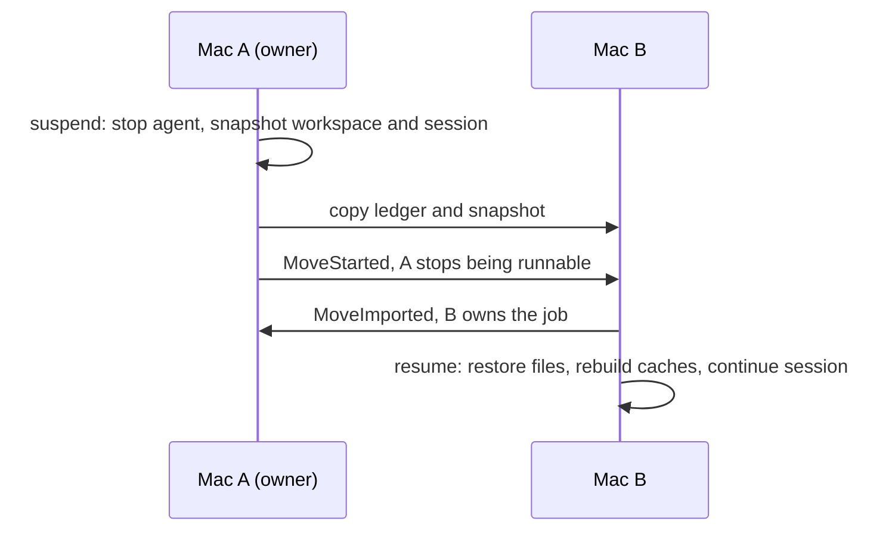

# Fabric

Fabric moves a coding-agent job from one machine to another and lets you pick it up where it stopped. The workspace goes with it: staged and unstaged changes, untracked files, dependency caches and build output. So does the agent's session, so Claude Code or Codex continues the same conversation on the other machine. Untracked secret-shaped files such as `.env` stay behind. A secret that is tracked or stashed in git is already in the repository's history, so it travels with the git state, and suspend names it instead of refusing. The session is redacted by pattern, which removes common key shapes, not every secret.

The idea underneath is that the job, not the machine, is the unit of development work. Where a job's state is stored, which machine runs it, which toolchain it needs and which agent drives it are separate questions, and Fabric keeps them separate, so a job started under Claude Code on one machine can be suspended, resumed on another machine with its dependencies, and continued by a different agent.

Fabric is a working name. It collides with Microsoft Fabric and others, and may change; see [ADR 0010](docs/adr/0010-name-and-scope-boundaries.md).

## Status, honestly

A job can move between two of your Macs by hand: made from a repository, run under a harness, suspended, moved, resumed on the other Mac with its uncommitted work and its harness session, and moved back, safe under `kill -9` of either node at every step the end-to-end test names.

On 2026-10-21 a Codex job moved between two real Macs with its workspace and its conversation. It answered a first turn on one Mac, was suspended and moved to the other, and there it resumed and answered a question about its first turn.

| Step | Measured |
|---|---|
| Suspend: stop the agent, snapshot the workspace and the session | 0.85 s |
| Move to the other Mac | 1.15 s |
| Resume and run one headless turn there | 6 s |
| Workspace on the target | Identical to the source: git status, staged and unstaged diffs, the untracked file, `node_modules` and `dist`. `.env` was left behind, as a secret is. |

That run found that the resumed agent used the other Mac's model setting instead of the job's, and pinned the model by hand; a resume now carries the settings the session ran with (gate finding F10). Claude Code has not yet been run across two machines. The end-to-end test runs two nodes on one machine.

| What | State |
|---|---|
| Architecture page and glossary | Written: [docs/architecture.md](docs/architecture.md), [docs/glossary.md](docs/glossary.md) |
| ADRs 0001 to 0016, 0018 | Written, see below; amended 2026-10-19 after the step 1 research; 0013 to 0016 record the network protocol, the store, the harness trait, and the node and CLI as built; 0018 records the client API |
| `crates/fabric-core` | Ids, paths, the job ledger with its record codec, the lease and the cooperative move protocol, snapshot manifests, the environment spec and the secret policy. Pure: no IO, no clock, no socket. Property-tested against the ADR 0003 invariants; the secret staging contract is tested against real `git`. |
| `crates/fabric-store` | Content-addressed objects (blake3, zstd, FastCDC above 8 MiB), the SQLite catalog with refcounts and a graced gc, workspace capture (git state as two private commits and a bundle, ignored files by class, secrets denied) and restore into an empty directory through a staging rename. Crash-tested with `SIGKILL` at every publish and restore checkpoint. Capture still applies its own secret list, not `fabric_core::secret` (ADR 0004). |
| `crates/fabric-net` | Node key, pinned TLS with no CA, QUIC and TCP+TLS transports on one port behind one endpoint, framed and typed RPC with deadlines, paged ledger records, verified zstd chunk transfer, the facts doctor compares, the peer book. See [docs/net.md](docs/net.md). |
| `crates/fabric-harness` | The `Harness` trait and three adapters: Claude Code, Codex and any Agent Client Protocol agent. Captures a session into a redacted state tree with a manifest, restores it all or nothing under the same workspace path and home, never over state that would lose bytes, launches the harness in a new process group with typed flags and without the markers of a Claude Code or Codex session Fabric runs under, holding an interactive one stopped before its exec until its group owns the terminal (gate finding F5), and reads the answer and session a headless Claude or Codex turn prints. Pre-seeds Claude's workspace trust under the key Claude reads for project settings (the main checkout of the repository, or the workspace) only when that key is not already set, and leaves it to Claude while one runs or when `~/.claude.json` is missing or a symlink, saying when a trusted ancestor still skips the dialog but leaves the project settings off. A hard-coded denylist keeps credentials and host state out of the tree. Crash-tested with `SIGKILL` after every staged and placed Claude file, after a pending departure record, and in a Codex restore. |
| `crates/fabric-env` | `EnvSpec` detection from the files a workspace already has and from `.fabric/env.toml`, and the materializer that runs setup steps only when a cache is missing or torn, with a dry run. Tested against fixture workspaces, real setup processes and `SIGKILL`. |
| `crates/fabricd` | The node: one process per state directory holding the store, one ledger file per job, the network service and the control socket. Suspend, the push move, the pull resume, the steal behind `--force`, doctor, and recovery after a restart. See [ADR 0016](docs/adr/0016-node-and-cli-as-built.md). |
| `crates/fabric-client` | The client API of a node (ADR 0018): typed requests, replies, progress events and refusals as length-prefixed JSON on the control socket after a version handshake, and a Rust client. `protocol/fixtures` holds one example of every message; the Rust and TypeScript clients both test against it. |
| `sdk/typescript` | The TypeScript client of the same API for Node 22 and Bun, built to JavaScript with declarations in `dist/`: zod schemas at the boundary, the same trust checks and handshake as the Rust client, and the same contract test against `protocol/fixtures`, plus an end-to-end test against a real node and a test that imports the packed package with plain Node from `node_modules`. |
| `crates/fabric` | The `fabric` command, and the end-to-end test: two daemons over loopback on QUIC and on TCP+TLS, a job moved and back, the move broken at five named points by `SIGKILL` of either node or a lost or repeated answer. |
| CI | fmt, clippy, test, the end-to-end test, doc, `cargo deny`, the hygiene script, and the TypeScript SDK's typecheck, build, contract, package and end-to-end tests, on macOS and Ubuntu |

## How a move works



- **One live copy.** Every job has an append-only, hash-chained ledger. A move is a short protocol over that ledger, so at most one machine can run the job at a time, even when a machine is killed in the middle of a move.
- **Content-addressed snapshots.** The workspace is stored as blake3 chunks in a local store with a SQLite catalog. A move sends only the chunks the other machine lacks. Git state goes as a bundle plus the index and the working tree.
- **Carry or rebuild.** Dependency caches and build output travel when the other machine can use them, and are made again there by their setup step or the next build when it cannot. Untracked secret-shaped files stay on the machine; tracked and stashed ones travel inside the git state and are named, not hidden (ADR 0014).
- **Harness adapters.** Claude Code, Codex and any Agent Client Protocol agent. Each adapter captures the agent's session files and restores them on the other machine.
- **Pinned peers.** Machines pair by ed25519 node id and talk over QUIC with TLS pinned to that id, or TCP with TLS when UDP is blocked. No central server.
- **Client API.** A versioned JSON API on the node's local socket, with a Rust client crate and a TypeScript SDK checked against the same message fixtures.

## Two Macs, by hand

Both Macs need the same user name and the same home path (ADR 0011), and `git` on the `PATH` (the store restores git state with it). On the gate, the Pro is behind a NAT and the Air has an address the Pro can reach, so the Pro dials and the Air listens.

Build once, on the Pro, and copy the binary:

```sh
cargo build --release -p fabric
scp target/release/fabric air:/usr/local/bin/fabric   # any directory on the Air's PATH
cp target/release/fabric /usr/local/bin/fabric
```

Start a node on each Mac and leave it running (a terminal tab is enough):

```sh
fabric serve            # listens on 0.0.0.0:7777; --wire tcp-tls if UDP is blocked
```

Start `fabric serve` from the Mac's desktop session: a Terminal window there, or a launchd user agent. A daemon started over SSH cannot read the Claude Code login in the Keychain, so it reports no login, and `fabric doctor` says so.

Pair them. Each prints its id with `fabric node id`.

```sh
# on the Pro: the Air's id and the address the Pro reaches it at
fabric node add fab1<air-id> <air-address>:7777
# on the Air: the Pro's id only; the Air never dials the Pro
fabric node add fab1<pro-id>
# on the Pro
fabric node ping fab1<air-id>
fabric doctor --peer fab1<air-id>
```

Make a job and work on it on the Pro:

```sh
fabric job new --repo ~/oss/some-repo --goal "fix the flaky test"   # prints the job id
fabric job run <job>        # Claude Code in this terminal, at ~/fabric/jobs/<job>/work
```

You do not need to close Claude Code first, and you can type the command inside a Claude Code session. The harness starts without the markers of the session it was typed in (`CLAUDECODE`, `CLAUDE_CODE_*` and the rest ADR 0015 lists), so it is a session of its own and saves its transcript, which `resume` needs.

Before it starts Claude, `run` makes sure Claude trusts the job's folder, and says where that trust came from:

- Nothing printed: Claude already trusted the folder, through the key Claude reads for project settings (the repository's main checkout, or the folder).
- `trusted <path>`: Fabric wrote that key into `~/.claude.json`.
- `warning: Fabric did not trust <path> (<reason>); ...`: Fabric left `~/.claude.json` alone, because another `claude` runs and rewrites that file itself, or because the file is missing or a symlink. The harness starts anyway. If no trusted parent folder covers the job, Claude shows its own trust dialog; accept it once. If one does, the warning says which, and Claude skips the dialog but ignores the folder's project settings (permission rules, `.mcp.json` servers, hooks) until the key is set. To have Fabric set it, run the job again while no other `claude` runs.

Exit the harness, then move the job:

```sh
fabric job suspend <job>                 # stops the harness if it still runs, snapshots, copies to the Air
fabric job move <job> --to fab1<air-id>  # the Air owns the job from here; the Pro's copy never runs again
```

Before anything changes hands, `move` prints one line per ignored path of the snapshot it takes, and why: `carry`, `rebuild` with the setup step that makes it again on the Air, `refuse`, or `leave` for a secret or for build output made for another os or arch. A `node_modules` or `.venv` with no lockfile always travels, because nothing on the Air could make it again. A refusal stops the move, and `--force` carries the path as it is. `fabric doctor --peer fab1<air-id> --job <job>` prints the same lines for the latest snapshot, and `fabric job status <job>` and `move` say when the snapshot holds no harness session, so the conversation would not continue on the Air.

On the Air:

```sh
fabric job resume <job>     # restores at the same path, runs setup steps, continues the same session
```

A job can also take one turn without a terminal. `fabric job run <job> --headless --prompt "..."` and `fabric job resume <job> --headless --prompt "..."` run Claude as `claude -p --output-format json` or Codex as `codex exec --json`, print the turn's answer and a last line naming the session (`codex session <thread>`) on standard output, with everything else on standard error, and record the run like an interactive one, so the next suspend captures the session. Ctrl-C, or the hang-up of a closed SSH session, is passed on to the harness rather than leaving its turn running unattended. This is the path for a job started from another device, such as a command sent over SSH with no terminal on the other end; an interactive run needs the terminal it was typed in. Nobody is there to answer a permission prompt: a headless Claude turn is denied every tool call that would ask, unless the workspace's permission rules allow it. Codex runs `exec` with approvals off, except on a node that sends approvals to auto review, where it keeps that node's own approval policy and the reviewer model answers; `codex exec` decides this itself, on a resume too. It runs in a workspace-write sandbox because the trust override marks the workspace trusted, unless it resumes a thread, which keeps its own model, effort and sandbox (below).

To bring it back, on the Pro, `fabric job resume <job>` pulls it from the Air. `fabric job status <job>` and `fabric job log <job>` say where the job is and why on either Mac. `FABRIC_LOG=debug` shows what a node does.

On the gate as measured, the Macs run different Claude Code versions, which doctor refuses for a Claude job; `fabric job move ... --force` (and `fabric job resume ... --force` for a pull) waives that row and prints it. Close every `claude` on the Air before a resume there: restoring a Claude session refuses while any `claude` runs on a Claude older than 2.1.294, because its session registry is too old to tell which sessions run (ADR 0015). This is about the session state the resume writes, not trust, and the Pro, on 2.1.294, has no such rule.

A resume continues with the settings the session ran with, not the ones the other Mac has configured: Codex gets the thread's model with the provider that served it, effort and sandbox, and in a terminal its approval policy and approvals reviewer, except a `never` policy, which `codex exec` records for the turns it runs, and the reviewer that goes with a policy it leaves out (a headless `codex exec` sets its own policy and restores the reviewer itself), and Claude gets the transcript's model, and `fabric` prints them on the `continuing ... session` line, with one line for any recorded value it does not carry and why. A resume refuses to start a harness older than the newest one that wrote the session, because an older Codex left a moved session that the newer one refused afterwards (gate finding F10). Codex records its version only when it creates a thread, so the job also carries the version of the newest Codex that ran it under Fabric, the one a version manager pins in the workspace included; `--force` on the move does not change that, so update the harness on that Mac and resume again (ADR 0006).

## Known limits

- No triggers: nothing suspends on sleep or lid close; every move is a command you type (ADR 0008).
- Two nodes and no witness: a move whose target vanishes after `MoveStarted` freezes the job on the source until the target answers, or until a steal with `--force` on another node (ADR 0003). There is no `move --abort` yet.
- No phone or cloud client, and no third node.
- Same user and home on both nodes; nothing rewrites paths (ADR 0011).
- `fabric job init`, which adopts a checkout in place, is not built; `job new` clones the repository into `~/fabric/jobs/<id>/work`.
- No `fabric orphan export` and no fork rule: an orphan workspace is reported and left in place, or moved to `orphan/<epoch>` beside the root when the job comes back and a restore needs the root, never deleted, and a node whose ledger forked after a steal freezes the job, stops its harness and says in `fabric job status` which node to continue on.
- The node must run: every job command talks to it, and it supervises the harnesses it launched.
- A network change can cut the two Macs apart (gate finding F3). The Pro moved from one subnet to another between two days of the gate and could no longer reach the Air's address. The side that dials must be the side that can reach the other: pair with an address it reaches today, and run `fabric node add` again with the new address when it changes. Nothing finds a peer that moved. Tailscale as an optional underlay, so the address stays the same across networks, is a follow-up.

## Decisions

| ADR | Title |
|---|---|
| [0001](docs/adr/0001-job-as-unit-of-work.md) | The job is the unit of work |
| [0002](docs/adr/0002-job-ledger-and-record.md) | Job ledger and record |
| [0003](docs/adr/0003-exactly-one-live-copy.md) | Exactly one live copy |
| [0004](docs/adr/0004-content-addressed-snapshots.md) | Content-addressed snapshots |
| [0005](docs/adr/0005-transport-and-node-identity.md) | Transport and node identity |
| [0006](docs/adr/0006-harness-adapters.md) | Harness adapters |
| [0007](docs/adr/0007-environment-spec.md) | Environment spec |
| [0008](docs/adr/0008-placement-and-triggers.md) | Placement and triggers |
| [0009](docs/adr/0009-engineering-conventions.md) | Engineering conventions |
| [0010](docs/adr/0010-name-and-scope-boundaries.md) | Name and scope boundaries |
| [0011](docs/adr/0011-path-identity.md) | Path identity |
| [0012](docs/adr/0012-dependency-carry.md) | Dependency carry |
| [0013](docs/adr/0013-network-protocol-as-built.md) | The network protocol as built |
| [0014](docs/adr/0014-store-as-built.md) | The store as built |
| [0015](docs/adr/0015-harness-trait-as-built.md) | The harness trait as built |
| [0016](docs/adr/0016-node-and-cli-as-built.md) | The node and the CLI as built |
| [0018](docs/adr/0018-client-api.md) | The client API |

Start with the architecture page, then read the ADRs in order. ADR 0003 deserves the most attention; it is the one that protects the user's work. The research notes the ADRs cite are private and live outside this repository; the architecture page says what they are.

## Building

Rust 1.97.1, pinned in `rust-toolchain.toml`.

```sh
cargo fmt --all --check
cargo clippy --workspace --all-targets -- -D warnings
cargo test --workspace
cargo build --release -p fabric     # target/release/fabric
```

`RUSTDOCFLAGS="-D warnings" cargo doc --workspace --no-deps`, `cargo deny check` and `scripts/check-hygiene.sh origin/main` complete the set; see [CONTRIBUTING.md](CONTRIBUTING.md).

## License

MIT. See [LICENSE](LICENSE).
