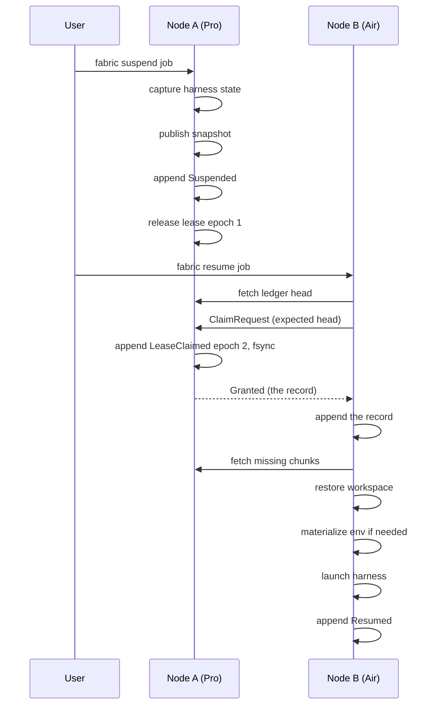

# Fabric architecture

Status: design only. No code behind this page yet. See the [README](../README.md) for what exists.

## The one idea

The unit of development work is a job. Not a machine, not a chat session, not a folder.

A job is a goal plus the state needed to keep working on it. Where that state is stored, which machine runs it, what toolchain it needs and which agent drives it are four separate questions. Fabric keeps them separate so that each can change without the others noticing.

## The four decoupled parts

| Part | What it holds | Who owns it in code | ADR |
|---|---|---|---|
| Job record | Goal, append-only event ledger, versioned manifest, pending decisions, an opaque state directory per harness | `fabric-core` | [0001](adr/0001-job-as-unit-of-work.md), [0002](adr/0002-job-ledger-and-record.md) |
| Storage | Content-addressed snapshots of the workspace: git objects and refs in a bundle, the index and the working tree as two snapshot commits, policy-selected ignored files such as `node_modules`, harness state | `fabric-store` | [0004](adr/0004-content-addressed-snapshots.md) |
| Compute | The node that holds the lease and runs the harness right now. Replaceable at any time. Exactly one live copy. | `fabric-node`, `fabric-net` | [0003](adr/0003-exactly-one-live-copy.md), [0005](adr/0005-transport-and-node-identity.md), [0008](adr/0008-placement-and-triggers.md) |
| Environment | `EnvSpec`: detected tool versions, setup commands, env var names, cache paths. Materialized on the node that resumes. | `fabric-env` | [0007](adr/0007-environment-spec.md) |

Harnesses (Claude Code, Codex, anything that speaks the Agent Client Protocol) are adapters on top of these four. The core never reads a harness's files; it moves them as opaque bytes. See [0006](adr/0006-harness-adapters.md).

## Crate layout (planned)

```text
crates/
  fabric-core      job, ledger, manifest, lease state machine, trait definitions
  fabric-store     chunking, blob store, SQLite catalog, snapshot publish and restore
  fabric-net       node identity, Transport trait, QUIC and TCP+TLS, blob transfer, pairing
  fabric-harness   Harness trait, ACP adapter, Claude Code adapter, Codex adapter
  fabric-env       EnvSpec detection and materialization
  fabric-node      the long-running node process: lease holder, blob server, placement
  fabric-cli       the `fabric` binary: suspend, resume, status, node pair, node serve
```

Only `fabric-core` exists today, and it holds a placeholder. Dependency direction is strictly downward: `fabric-cli` depends on everything, `fabric-core` depends on nothing in the workspace. `fabric-core` defines the `Store`, `Transport` and `Harness` traits; the other crates implement them. Nothing in the core knows about QUIC, SQLite or any agent vendor.

## Data structures first

```text
JobId        = ULID
NodeId       = ed25519 public key (32 bytes)
Epoch        = u64, 0 until the first claim, increases by exactly 1 on every lease claim
SnapshotId   = blake3 hash of the manifest bytes
ChunkId      = blake3 hash of the chunk bytes

Event        = { id: ULID, prev: blake3 of previous event, epoch, kind }
EventKind    = Created | LeaseClaimed | LeaseReleased | SnapshotPublished
             | Suspended | Resumed | DecisionRecorded | Note

JobManifest  = { version, job_id, goal, harness_kind, env_spec: EnvSpecId,
                 latest_snapshot: Option<SnapshotId>, lease: LeaseState }
LeaseState   = Free | Held { node, epoch, expires_at } | Released { epoch }

SnapshotManifest = { version, job_id, parent: Option<SnapshotId>, created_at,
                     platform: { os, arch }, entries: [Entry], harness_state: [Entry] }
Entry        = { rel_path: RelPath, kind: File | Dir | Symlink, mode, mtime_ns, chunks: [ChunkId], size }

EnvSpec      = { version, tools: [{ name, version, source }], setup: [{ argv, cwd, when }],
                 env_var_names: [String], cache_paths: [RelPath] }
```

Every id is either content-derived (hashes) or time-sortable and collision-free (ULIDs). Nothing is a host path. Nothing is a vendor session id.

## Data flow: suspend on one node, resume on another

The first gate: a job started under Claude Code on the MacBook Pro, suspended, resumed on the MacBook Air over the network, `node_modules` included, safe under `kill -9` at any step.



Step by step, with the failure each step must survive:

1. `fabric suspend <job>` on A. The harness adapter asks the agent to stop at a turn boundary and reports its state directory. If the agent cannot stop cleanly, suspend fails and nothing is written. The job stays live on A.
2. A publishes a snapshot in the order ADR 0004 fixes: new chunks to `tmp/`, `fsync`, rename into `chunks/`; chunk rows; the manifest by the same temp and rename; the snapshot rows; directory `fsync`; and only then the `SnapshotPublished` ledger event, which is the single commit point. A crash anywhere before the event leaves unreferenced chunks, or an unreferenced manifest with catalog rows, all invisible until an event names them and all removable by `fabric store gc`. A crash after the event leaves a complete snapshot.
3. After `SnapshotPublished`, A appends `Suspended`, then `LeaseReleased { epoch: 1 }`. Each append is a checksummed, fsynced record. A torn tail is truncated on open; any other damage fails closed (ADR 0002).
4. `fabric resume <job>` on B. B fetches A's ledger head. If the lease is `Held`, B refuses and says which node holds it and until when. If it is `Released`, B sends `ClaimRequest { expected_head }` to A, the arbiter. A checks that the head matches and the lease is released, appends `LeaseClaimed { node: B, epoch: 2 }`, `fsync`s, and replies `Granted` with the record. B appends that record to its replica. From then on A refuses any write, blob push or ledger append carrying epoch 1. If `Granted` is lost, B sends the same request again and gets the same record back. If A is unreachable there is no claim; `fabric resume --force-expired` is the user's explicit way past that (ADR 0003).
5. B fetches the manifest and only the chunks it lacks. Transfer is resumable: B asks per chunk id; a dropped connection restarts at the next missing chunk.
6. B restores into a path chosen by policy, never by the user. If that path already holds a workspace, its marker decides: the same snapshot means skip, a cleanly suspended older snapshot means update in place, anything else means refuse and point at `fabric orphan export`. A fresh restore writes into a temp directory and renames at the end, so a crash leaves no half workspace. The root is the same absolute path on both nodes (ADR 0008), so nothing inside harness state is rewritten; Claude Code's signed thinking blocks would not survive it (ADR 0006).
7. If the snapshot's `platform` matches B and the cache paths restored, nothing runs. Otherwise `fabric-env` runs the `EnvSpec` setup steps (for example `pnpm install`).
8. The harness adapter launches the agent against the restored state and appends `Resumed`.

If B dies between steps 4 and 8, B holds the lease with epoch 2 and the job is not lost: the snapshot is still on A, the ledger says B claimed. Running `fabric resume` again on B finishes the restore if it did not complete, skips it when the workspace marker already names the snapshot, and relaunches (ADR 0004). Nothing claims epoch 3 by itself: resuming on A instead needs `fabric resume --force-expired` after B's lease has expired, and the command prints what B may have left behind. Once epoch 3 exists, the epoch-2 claim can never write again.

## In scope now

- One job, two nodes, both Efe's own Macs, same OS and CPU architecture.
- Claude Code first, Codex second, ACP as the generic path.
- Explicit `suspend` then `resume`. No automatic triggers.
- `node_modules` and similar caches carried in the snapshot when platform matches.
- Own QUIC transport with node keys. Tailscale is a network Fabric can run over, not a dependency.
- Rust only. Library crates plus one CLI binary. Not an MCP server.

## Later, with an ADR each

- Failover when the source node is asleep or dead (needs replication before loss; see ADR 0003).
- Sleep and lid-close triggers (ADR 0008 names the watcher as later).
- Cross-harness resume through a neutral brief (ADR 0006 calls this an experiment, not a promise).
- Three or more nodes with quorum-based leases.
- Phone and cloud nodes. GPU nodes as a placement target.
- `devcontainer.json` import into `EnvSpec`.
- Cross-platform cache carry. Out of scope until same-platform carry is proven.

## How to read the ADRs

Read them in number order. 0001 and 0002 define the data. 0003 is the one that protects the user's work and is worth the most review time. 0004 and 0005 are the storage and network mechanics. 0006 and 0007 are the adapters. 0008 is deliberately thin. 0009 is how we work. 0010 is what Fabric is not.
